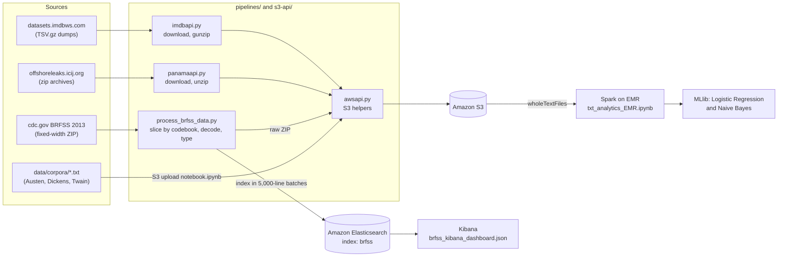

# Systems-Engineering

Northwestern University, M.S. in Data Science (Data Engineering specialization) · MSDS 436: Analytics Systems Engineering

## Overview

This repository is my MSDS 436 work on building data systems on AWS rather than analyzing a single dataset. It covers the plumbing a data engineer owns: a reusable S3 access layer exposed three ways (CLI, REST, GraphQL), ingestion scripts that pull public dumps (IMDb, ICIJ Offshore Leaks, CDC BRFSS) into S3, a fixed-width survey ETL that indexes into Amazon Elasticsearch for Kibana dashboards, a relational baseline in PostgreSQL, and a Spark job on EMR that does author attribution over a literary corpus stored in S3.

## Architecture



The same S3 operations in `awsapi.py` are also served over HTTP by `aws_restapi.py` (Flask) and `aws_graphapi.py` (Graphene), so the CLI, REST, and GraphQL surfaces can be compared side by side.

## Highlights / Results

| Work | Method | Result | Source |
|------|--------|--------|--------|
| Author attribution (3 authors, 15 texts, 5 per author) | Spark ML Tokenizer, StopWordsRemover, NGram (2 to 4), CountVectorizer, plus lexical and POS-tag features; MLlib `LogisticRegressionWithLBFGS` | Training accuracy 1.00 (12 of 12 texts); held-out texts (Austen2, Dickens3, Twain5) all 3 classified correctly | `txt_analytics_EMR.ipynb` (saved outputs) |
| Author attribution, same features | MLlib `NaiveBayes` | Training accuracy 0.83 (one Dickens text labeled Austen, one labeled Twain; Dickens recall 0.50); held-out texts all 3 classified correctly | `txt_analytics_EMR.ipynb` (saved outputs) |
| BRFSS 2013 survey ETL | Schema-driven slicing of fixed-width records using a codebook map, code decoding, bulk indexing to Elasticsearch | Codebook covers 332 variables, 92 flagged `Keep = Yes` for indexing; index mapping defines 112 fields | `pipelines/mapping_variable_list.csv`, `pipelines/mapping_brfss.json` |
| BRFSS dashboards | Kibana saved objects | 2 dashboards (Fitness, Nutrition) and 28 visualizations | `pipelines/brfss_kibana_dashboard.json` |
| S3 access layer | boto3 functions behind a CLI, 16 Flask routes, and Graphene queries/mutations | Two moto-backed unit tests (list buckets, create bucket in a region) pass without AWS credentials | `s3-api/`, `tests/test_awsapi.py` |
| Relational baseline | Northwind schema in PostgreSQL | 14 tables created; 16 analytical queries (subtotals, sales by year/category, quarterly orders, invoices) | `01-PostgreSQLNorthwindScriptDDLDML.sql`, `02-PostgreSQL_NorthwindInsights.sql` |

A note on the attribution numbers: the training set is 12 documents and the test set is 3, so these results show the pipeline works end to end, not that the classifier generalizes. Logistic regression reaching 1.00 on its own training data is expected with 60+ features and 12 rows.

## Engineering decisions and tradeoffs

- **One S3 module, three interfaces.** `s3-api/awsapi.py` holds the boto3 logic; the ingestion scripts import it, and the REST and GraphQL services mirror its operations. That kept upload behavior identical across the IMDb, Panama, and BRFSS pipelines. The tradeoff is that the REST and GraphQL files reimplement the calls rather than importing `awsapi`, so a fix has to be applied in three places.
- **Codebook-driven parsing for BRFSS.** Each BRFSS record is one long fixed-width string. Instead of hardcoding offsets, `process_brfss_data.py` reads start column and field length from `mapping_variable_list.csv` and keeps only rows flagged `Yes`. Adding a field is a CSV edit, not a code change. State and activity codes are decoded from `mapping_state.csv` and `mapping_activity.csv`, and state centroids are attached so Kibana can draw maps.
- **Batching before indexing.** The extracted BRFSS file is split into 5,000-line chunks and each chunk is turned into a DataFrame and indexed. That bounds memory on a small EC2 instance. Documents are indexed one at a time with `es.index`, even though `helpers` (the bulk API) is imported; switching to `helpers.bulk` would be the obvious speedup.
- **Elasticsearch for the survey, PostgreSQL for Northwind.** The survey data is wide, mostly categorical, and meant for faceted exploration in Kibana, which suits a document index. Northwind is normalized and join-heavy, which suits SQL. Doing both in one course made the store choice explicit.
- **Spark on EMR reading S3 directly.** `sc.wholeTextFiles("s3://...")` keeps each novel as one record, which is what document-level features need. It only works on EMR (where S3 is mounted as a Hadoop filesystem), and `emr_install.sh` bootstraps NLTK data on every node because the POS-tag and sentence features run inside Spark tasks.
- **Mocked cloud tests.** `tests/test_awsapi.py` uses moto's `mock_aws` so the S3 layer is tested without credentials or cost.

## Limitations and what I would do differently today

- The Spark notebook is not parameterized: the S3 input path, the train/test split, and the label mapping (a SQL `CASE` on file names) are hardcoded. Today I would make it a `spark-submit` job with arguments, and use cross-validation since 15 documents is too few for a single split.
- Pipelines are run by hand from a command reference (`s3-api/Commands2RunScripts.txt`). I would orchestrate download, upload, and index steps in Airflow (or Step Functions) with retries and idempotent S3 keys.
- `process_brfss_data.py` targets the elasticsearch-py 7.x API (`doc_type`, `include_type_name`, `RequestsHttpConnection`), which current OpenSearch/Elasticsearch clients have removed. It would need a client upgrade and the bulk helper.
- Test coverage is limited to two S3 functions. The parsing logic in the BRFSS ETL is the part most worth unit testing (a few synthetic fixed-width lines would do it).
- Raw data is not versioned; each run re-downloads from the source sites, which may have changed or moved since the original run.

## Repository map

| Path | What it is |
|------|------------|
| `s3-api/awsapi.py` | boto3 S3 helpers (bucket, folder, and file create/list/exists/delete, upload/download) with an argparse CLI |
| `s3-api/aws_restapi.py` | Same operations as Flask routes (port 5004) |
| `s3-api/aws_graphapi.py` | Same operations as a Graphene schema served with flask-graphql |
| `s3-api/AWS S3 Operations.postman_collection.json` | Postman collection for the REST API (points at the original EC2 host; replace with your own) |
| `s3-api/Commands2RunScripts.txt`, `s3-api/graphql_queries.txt` | Command and query references for the CLI and GraphQL API |
| `pipelines/imdbapi.py` | Scrapes the IMDb dataset index, downloads TSV.gz dumps, gunzips, uploads to S3 under a date prefix |
| `pipelines/panamaapi.py` | Same pattern for ICIJ Offshore Leaks (Bahamas, Offshore, Panama, Paradise) zip archives |
| `pipelines/process_brfss_data.py` | BRFSS 2013 download, S3 upload, fixed-width parse, decode, Elasticsearch index |
| `pipelines/mapping_*.csv`, `pipelines/mapping_brfss.json` | BRFSS codebook offsets, state and activity lookups, Elasticsearch mapping |
| `pipelines/ElasticSearchImportDataValidation.py` | Connects to the Elasticsearch domain and prints the document count |
| `pipelines/brfss_kibana_dashboard.json` | Kibana dashboards and visualizations export |
| `pipelines/imdb import steps.txt` | Notes for loading the IMDb TSVs from S3 into Redshift staging tables |
| `txt_analytics_EMR.ipynb` | Spark author attribution on EMR (feature engineering, MLlib LR and Naive Bayes) |
| `S3 upload notebook.ipynb` | Uploads `data/corpora/` to S3 using `awsapi` |
| `data/corpora/` | 15 public-domain texts: Austen1 to 5, Dickens1 to 5, Twain1 to 5 |
| `01-PostgreSQLNorthwindScriptDDLDML.sql`, `02-PostgreSQL_NorthwindInsights.sql` | Northwind schema and data; analytical SQL |
| `emr_install.sh` | EMR bootstrap: boto3 and NLTK corpora on each node |
| `tests/test_awsapi.py` | moto-mocked unit tests for `awsapi` |
| `course-materials/` | **Course-provided reference material, not my work.** Instructor tutorials (`01-PandasTutorial.ipynb`, `02-SparkSQLTutorial.ipynb`, `03-GettingStartedWithPySpark.ipynb`, `WebScraper-Example1.ipynb`) and the sample datasets only they use (`iris.csv`, `titanic.csv`, `winequality-red.csv`, `winequality-white.csv`, `sample.txt`). Kept unmodified for context. |

`s3-api/Commands2RunScripts.txt` and `s3-api/graphql_queries.txt` carry the course instructor's header.

## Reproducing

- Python 3.8 or later. Install dependencies with `pip install -r requirements.txt`. The Elasticsearch scripts need the 7.x client (`pip install "elasticsearch<8"`), and `aws_graphapi.py` needs graphene 2.x with flask-graphql.
- AWS credentials come from the standard boto3 chain (`~/.aws/credentials` or `AWS_ACCESS_KEY_ID` / `AWS_SECRET_ACCESS_KEY`).
- Environment variables used by the scripts:

  | Variable | Used by | Notes |
  |----------|---------|-------|
  | `S3_BUCKET` | `imdbapi.py`, `panamaapi.py`, `process_brfss_data.py`, `S3 upload notebook.ipynb` | Default for `-b`; the scripts exit with an error if neither is given |
  | `ES_HOST` | `process_brfss_data.py`, `ElasticSearchImportDataValidation.py` | Elasticsearch domain endpoint without scheme; required |
  | `AWS_REGION` | same as `ES_HOST` | Region for SigV4 signing; defaults to `us-east-2` |

- Run the scripts from the repository root, for example:

  ```bash
  export S3_BUCKET=my-bucket
  python3 pipelines/imdbapi.py -o imdb -d /tmp/temp_imdb -l INFO
  python3 pipelines/panamaapi.py -o panama -d /tmp/temp_panama -l INFO

  export ES_HOST=search-<domain>-<id>.us-east-2.es.amazonaws.com
  python3 pipelines/process_brfss_data.py -o brfss -d /tmp/temp_brfss
  python3 pipelines/ElasticSearchImportDataValidation.py
  ```

- Data sources: IMDb dumps from https://datasets.imdbws.com/, ICIJ archives from https://offshoreleaks.icij.org/pages/database, BRFSS 2013 from the CDC URL in `process_brfss_data.py` (all downloaded at run time, not bundled). The literary corpora are included in `data/corpora/`.
- Spark notebook: upload `data/corpora/*.txt` to S3, edit the `s3://` path in the `wholeTextFiles` cell, and run on an EMR cluster bootstrapped with `emr_install.sh`.
- Tests: `python -m pytest tests` (no AWS account needed).
- Notebooks reflect the original course run; saved outputs are from that run and were not regenerated.

## Stack

| Layer | Tools |
|-------|-------|
| Language | Python 3, SQL, Bash |
| Cloud | AWS S3, Amazon Elasticsearch Service, EMR/YARN, Spark |
| AWS SDK / auth | boto3, requests-aws4auth (SigV4) |
| Web APIs | Flask, Flask-RESTful, Graphene, flask-graphql |
| Data processing | pandas, NumPy, PySpark, Spark ML / MLlib, NLTK |
| Search / viz | elasticsearch-py, Kibana |
| Relational | PostgreSQL (Northwind), Redshift staging notes |
| Scraping / HTTP | requests, BeautifulSoup |
| Testing | pytest/unittest, moto (`mock_aws`) |
| Ops artifacts | Postman collection, GraphQL query reference, EMR bootstrap script |
